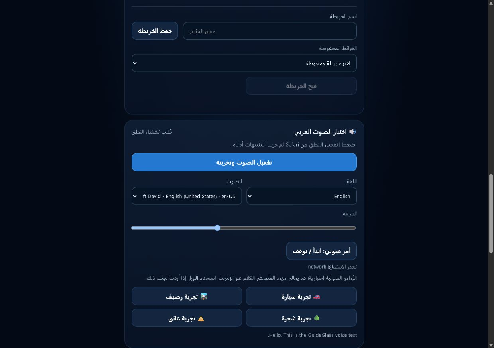
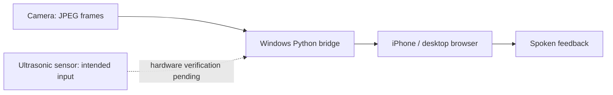

# GuideGlass AI

### More awareness. Less uncertainty.

A wearable assistive-technology prototype exploring how a **camera, an ultrasonic distance sensor, and spoken feedback** can make nearby surroundings easier to understand for people who are blind or have low vision.

The engineering goal is simple: turn useful environmental information into a clear, timely cue—not another screen someone must watch.

*Real application screenshot. A photograph of the assembled glasses is still needed.*

## Built around a practical signal path

- **Camera transport:** a real JPEG reached the bridge during a recorded live check.
- **Distance-aware alerts:** software accepts valid readings and can request an Arabic warning; physical distance sensing still needs a successful test.
- **Browser interaction:** voice, language, and speed controls, with manual demonstrations separated from sensor events.
- **Inspectable engineering:** source code, software tests, and dated evidence instead of unsupported performance claims.

## Evidence before claims

The recorded check on **15 October 2026** returned HTTP 200 for the bridge and camera, receiving a **7,359-byte JPEG**. The distance endpoint returned **HTTP 502**: an end-to-end ultrasonic demonstration is **not yet verified**. The earlier recorded software suite passed **49 tests**; those are not physical sensor or navigation tests.

[Recorded evidence](docs/evidence/README.md) · [Hardware status](docs/HARDWARE.md) · [Verification boundaries](docs/VERIFICATION.md)

## Run it on Windows

Install Python 3.12, run `setup_windows.bat`, then `start_windows.bat`. Open **http://localhost:8766/** and configure the device address in the app. Setup downloads dependencies and model/browser assets.

[Windows + iPhone guide](docs/QUICKSTART.md) · [Python bridge](server.py) · [Tests](tests/)

## Next milestone

Document the assembled glasses, confirm the sensor and electrical interface, then compare real distance samples with known targets and evaluate audible cues in a controlled setting. Spatial-reconstruction research remains in the source; it is not a claim of LiDAR-grade accuracy.

**Research prototype—not a navigation or medical safety device.** It must not replace a white cane, guide dog, or trained mobility support. No blind-user study or safe street-navigation capability has been demonstrated.

Created by [ali9235](https://github.com/ali9235) · [Repository](https://github.com/ali9235/GuideGlass-AI)
