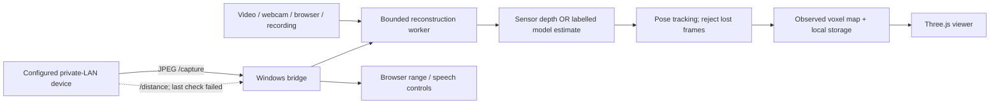

# GuideGlass AI: architecture and technical deep dive

Explore camera and intended ultrasonic cues for blind or low-vision users. Preserve the Windows/browser spatial research without presenting estimated depth as calibrated LiDAR or the prototype as a safe navigation device.

## System boundary

Solid arrows show implemented software flow or observed grouping. Dashed arrows identify optional, disabled or unverified paths. Neither is a recovered wiring schematic.

## Source map

| Module | Responsibility |
| --- | --- |
| [server.py](../server.py) | HTTP routes, Host/Origin checks, bounded uploads and device proxy |
| [sources.py](../guideglass/sources.py) | Inputs and image/video bounds |
| [models.py](../guideglass/models.py) | Local CPU depth/object inference from separately installed weights |
| [geometry.py](../guideglass/geometry.py) | Intrinsics, backprojection, tracking and voxel fusion |
| [engine.py](../guideglass/engine.py) | One worker, sessions, bounded inbox and map lifecycle |
| [storage.py](../guideglass/storage.py) | Schema-checked NPZ, manifests and binary PLY |
| [spatial.js](../static/spatial.js) / [index.html](../index.html) | Rendering, controls, face/voice and range presentation |

## Geometry and data flow

For registered pinhole data: X=(u-cx)Z/fx, Y=(v-cy)Z/fy, Z=depth. Coordinates use OpenCV x-right/y-down/z-forward; the browser reverses y/z. Assumed intrinsics retain provenance and are not calibration. Invalid/discontinuous depth is excluded. Tracking gates fusion; no unseen surfaces are synthesized. There is **no global loop optimization**. Saved maps reopen for viewing, not guaranteed relocalized continuation.

The tracker uses ORB features, descriptor matching and depth-backed 3D-to-2D correspondences with PnP RANSAC/refinement. Recent keyframes permit local relocalization; this is local visual odometry, not full globally optimized SLAM. The voxel map averages observed points in bounded cells rather than creating a mesh. The browser input inbox holds one frame and may drop older work; processing FPS is measured state, not a promised rate.

Indoor-model metric depth is an estimate, not a sensor range. Class/confidence and depth-derived object position do not prove motion/danger; motion_analysis is not_implemented. One ultrasonic value cannot calibrate a dense depth field. See [verification boundaries](VERIFICATION.md).

## HTTP interface

Control JSON requires Content-Type: application/json. This is an **unauthenticated local research interface**, not a public service.

| Method / path | Contract |
| --- | --- |
| GET /api/status | Bridge/configuration status |
| POST /api/device | Private LAN IPv4 in an ip field |
| GET /api/frame, /api/distance | Device JPEG/JSON; 503 unconfigured, 502 upstream error |
| POST /api/spatial/start | Source/options; at most one worker |
| POST /api/spatial/stop | JSON object; request stop |
| GET /api/spatial/state | Phase, provenance, tracking and processing state |
| GET /api/spatial/cloud?since=N | GGP1 binary cloud; 304 if unchanged |
| POST /api/spatial/frame?session=ID&timestamp=T | Bounded JPEG/PNG, active session; 202 accepted |
| POST /api/spatial/upload | MP4/MOV/octet-stream, up to 120 MB; decoded dimensions bounded |
| POST /api/spatial/save, /api/spatial/load | Name or map id; validation before access |
| GET /api/spatial/maps | Saved-map metadata |
| GET /api/spatial/maps/ID.ply | Validated-id PLY export |

Cloud header: 16 bytes; ASCII GGP1 followed by little-endian uint32 count, sequence, stride=24. Each point has six float32 values: xyz then normalized rgb. The browser bounds acceptance to 80,000 points. Errors include 400 invalid request, 403 Host/Origin, 404 absent route/data and 503 missing dependencies. Session ids are ingestion guards, **not user authentication**.

No commercial AI API key is needed for these local inference paths. Downloads happen separately during setup. See [Windows/iPhone setup](QUICKSTART.md).

## Distance and voice path

The browser accepts explicit distance_mm/mm or distance_cm/cm fields; a bare number is treated as millimetres. Explicit invalid/error flags, missing data and nonpositive/nonfinite values are rejected. A successful parse is not proof that the physical sensor is calibrated. When enabled by user interaction, a range below 100 cm may request a priority Arabic warning, throttled to more than seven seconds between warnings. Those thresholds are reference UI policy, not validated clearance criteria. Optional speech recognition may use the browser vendor's online services.

## Evidence boundary

Earlier camera transport succeeded; distance returned HTTP 502. No established root cause/fix, wearable ranging result, audible-effectiveness study, physical Safari validation or safe navigation result.

[Documentation index](ENGINEERING_STANDARD.md) · [Design decisions](DECISIONS.md) · [Security](../SECURITY.md)
